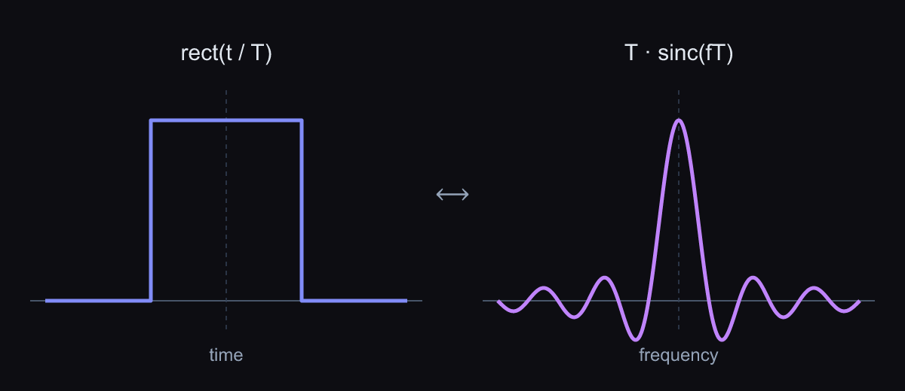

Most Fourier transform questions in a Signals and Systems paper are not really about integration.
They test whether you can spot which property turns the problem into one you have already solved.
This post collects the five tricks that come up again and again.

We use the ordinary-frequency convention throughout, so there are no stray $2\pi$ factors in front of the inverse transform.

## The transform pair

$$
X(f) = \int_{-\infty}^{\infty} x(t)\, e^{-j 2\pi f t}\, dt
\qquad\Longleftrightarrow\qquad
x(t) = \int_{-\infty}^{\infty} X(f)\, e^{j 2\pi f t}\, df
$$

The one pair worth memorising cold is the rectangular pulse. With $\operatorname{sinc}(x) = \dfrac{\sin(\pi x)}{\pi x}$,

$$
\operatorname{rect}\!\left(\frac{t}{T}\right) \;\Longleftrightarrow\; T \operatorname{sinc}(fT).
$$



A wider pulse gives a narrower main lobe: time and frequency trade off against each other.

## 1. Shift: delays only change the phase

$$
x(t - t_0) \;\Longleftrightarrow\; e^{-j 2\pi f t_0} X(f)
$$

The magnitude $|X(f)|$ does not change at all. If a question asks for the magnitude spectrum of a delayed pulse, you can skip the delay entirely.

## 2. Scaling: squeeze in time, stretch in frequency

$$
x(at) \;\Longleftrightarrow\; \frac{1}{|a|}\, X\!\left(\frac{f}{a}\right)
$$

This is where the $T$ in $T\operatorname{sinc}(fT)$ comes from: start from $\operatorname{rect}(t) \Leftrightarrow \operatorname{sinc}(f)$ and set $a = 1/T$.

## 3. Duality: read the table backwards

If $x(t) \Leftrightarrow X(f)$, then $X(t) \Leftrightarrow x(-f)$. So the transform of a sinc *in time* is a rectangle *in frequency*:

$$
\operatorname{sinc}(t) \;\Longleftrightarrow\; \operatorname{rect}(f).
$$

That is an ideal low-pass filter, and you got it without evaluating a single integral.

## 4. Convolution becomes multiplication

$$
(x * h)(t) \;\Longleftrightarrow\; X(f)\,H(f),
\qquad
x(t)\,h(t) \;\Longleftrightarrow\; (X * H)(f)
$$

The classic use: a triangular pulse is a rectangle convolved with itself. With $\operatorname{tri}(t) = \max(1 - |t|, 0)$,

$$
\operatorname{rect}\!\left(\tfrac{t}{T}\right) * \operatorname{rect}\!\left(\tfrac{t}{T}\right) = T \operatorname{tri}\!\left(\tfrac{t}{T}\right)
\quad\Longrightarrow\quad
\operatorname{tri}\!\left(\tfrac{t}{T}\right) \;\Longleftrightarrow\; T \operatorname{sinc}^2(fT).
$$

## 5. Parseval: energy is the same in both domains

$$
\int_{-\infty}^{\infty} |x(t)|^2\, dt \;=\; \int_{-\infty}^{\infty} |X(f)|^2\, df
$$

This turns some nasty frequency-domain integrals into trivial time-domain ones. For example,

$$
\int_{-\infty}^{\infty} \operatorname{sinc}^2(f)\, df \;=\; \int_{-\infty}^{\infty} \operatorname{rect}^2(t)\, dt \;=\; \int_{-1/2}^{1/2} 1\, dt \;=\; 1.
$$

You can check Parseval numerically with an FFT. Scaling by the sample rate makes the FFT approximate the continuous transform:

```python
import numpy as np

fs = 1000                                # samples per second
t = np.arange(-1, 1, 1 / fs)
x = (np.abs(t) <= 0.25).astype(float)    # a rect pulse 0.5 s wide

X = np.fft.fft(x) / fs                   # approximates X(f)
df = fs / len(x)                         # frequency resolution

energy_time = np.sum(np.abs(x) ** 2) / fs
energy_freq = np.sum(np.abs(X) ** 2) * df
print(energy_time, energy_freq)          # both ≈ 0.5
```

## A quick checklist for the exam

- Is the signal a shifted, scaled or modulated version of something in the table? Use properties 1 and 2.
- Does it look like a transform you know, but in the wrong domain? Use duality.
- Is it a product or a convolution of simple pieces? Multiply or convolve the other side instead.
- Does the question ask for total energy or an integral of $|X(f)|^2$? Reach for Parseval.

Spotted a mistake or have a favourite trick that is missing? Use the comments below, or edit this post on GitHub.
